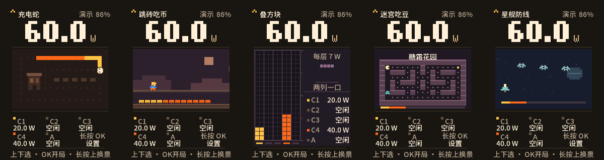
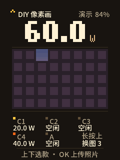

# CandyPin · 充电蛇

把 FoloToy AI Passport 变成小电拼的桌面充电仪表。240×320 屏幕显示五个端口的实时总功率和各口功率，中间用像素画面表现负载和功率分配。可以停在功率卡看动画，也可以用机身三键玩小游戏或展示自己的像素相册。

这是面向 **ESP32-C3、8 MB Flash 的 AI Passport** 的独立实验固件。当前源码是 **v0.5.4 预发布**，固件 ID 为 `candypin`。充电数据来自兼容的小电拼局域网接口或 MCP 服务，固件通过这些接口只读功率数据。

## 第一次安装 CandyPin

用电脑上的 Chrome 和一根支持数据传输的 USB-C 线。固件适用于 **ESP32-C3、8 MB Flash 的 FoloToy AI Passport**。

1. 下载 [v0.5.4 预发布固件](https://github.com/weixunkkkkk/passport-candypin/releases/tag/v0.5.4)中的 `candypin-full.bin`。上一发布版是 [v0.5.2](https://github.com/weixunkkkkk/passport-candypin/releases/tag/v0.5.2)。
2. 打开 [FoloToy 官方网页刷机工具](https://ai-passport.folotoy.cn/tools/web-flasher/)，进入「安装本地固件」。
3. 用 USB-C 数据线连接 Passport，选择下载的 `candypin-full.bin`，按网页提示选择串口并开始安装。
4. 等网页提示安装完成并让设备重启，再拔线。首次启动后按设备提示配网。

首次安装使用合并镜像，会替换设备上的固件，并可能清除原有配网和相册。刷写期间保持 USB 连接。找不到串口时，先换一根确定可传数据的线，再关闭串口监视器并重试。更新已有 CandyPin 且要保留设置时，见下方「从源码构建」中的应用分区更新方法。

[v0.5.4 下载与校验值](https://github.com/weixunkkkkk/passport-candypin/releases/tag/v0.5.4)



## 能做什么

- **功率可视化**。显示 C1、C2、C3、C4 和 USB-A 的功率，支持插拔提示、端口配色和 60 W 功率接力演示。叠方块功率卡按每层 7 W 绘制，140 W 正好满柱。
- **五款像素游戏**。充电蛇、跳砖吃币、叠方块、迷宫吃豆、星舰防线。待机可换场景，进入后可以操作、计分、结算和重玩。
- **DIY 像素相册**。手机在热点网页选图，浏览器将其转为 48×30、最多 32 色的像素画。设备可保存三张，在 192×120 的画框中逐块拼出。
- **连接与显示设置**。支持机身扫描 Wi-Fi、热点设置、局域网地址、HTTPS MCP、独立采样频率、亮度和息屏。息屏时背光和液晶一起休眠，后台继续采样。

## 上手

| 所在位置 | 操作 |
| --- | --- |
| 功率卡 | 上下键切卡，长按上键立即换景，短按 OK 开局，长按 OK 进设置 |
| 游戏内 | 按底部提示操作，长按上键暂停，短按 OK 继续，长按 OK 返回功率卡 |
| 结算 | 短按 OK 重玩，长按 OK 返回 |
| DIY 卡 | 短按 OK 开上传热点，长按上键在已保存的画位间切换 |

第一次配置时，手机连上机身显示的免密热点 `CandyPin-配网-XXXX`。系统会尝试打开配网页，也可以手动访问 [192.168.4.1](http://192.168.4.1)。选一个与小电拼同网的 2.4 GHz Wi-Fi，按需输入该网络的密码，再点「保存并连接」。同网只有一台兼容的小电拼时，CandyPin 会自动查找，IP 和 MCP 地址均可留空。需要远程读数时，可填小电拼 App 里复制的 HTTPS MCP 地址。

再次配网可进入 **设置 → 联网与读数 → 热点设置**，也可从机身扫描 Wi-Fi。曾经手动填过小电拼 IP 的用户，可在「局域网地址」里选「自动查找小电拼」。

| 数据来源 | 要求 |
| --- | --- |
| 局域网 | 自动查找同网唯一的 CP-02S，并读取 `/metrics.json` 五口数据。可手动指定 IPv4 地址 |
| MCP | HTTPS MCP 服务提供兼容的 `get_port_details` 工具 |
| 自动 | 优先读局域网。局域网读取失败时尝试已配置的 MCP，局域网恢复后切回 |

上传照片时，在 DIY 卡按 OK 并连接同一个免密热点，再打开 [像素画上传页](http://192.168.4.1/diy)。保存后在机身长按 OK 关闭热点并回到卡片。原照片在手机浏览器本地处理，设备接收并保存生成的像素数据。同一个画位保存时会覆盖旧图。



## 从源码构建

需要 ESP-IDF **5.5.3**、C 编译器和 Python 3。激活 ESP-IDF 环境后，在仓库根目录执行：

```sh
./tools/test-host.sh
idf.py build
idf.py merge-bin -o "$PWD/build/candypin-full.bin"
python3 tools/verify_firmware.py build
```

项目默认配置为 ESP32-C3、8 MB Flash。首次刷写请先核对硬件和分区布局，再用 `idf.py -p <串口> flash`。更新已安装本项目的设备时，确认分区表兼容后可用 `idf.py -p <串口> app-flash` 保留 NVS 数据。整片合并镜像从 `0x0` 写入，可能覆盖配网和相册。

GitHub Releases 提供网页刷机用的合并镜像。v0.5.4 的构建、主机测试和合并镜像校验已通过。手机自动打开配网页、Passport 直连读数和 MCP 读数待真机验证。预览中的功率和图片是演示数据。

## 来源与许可

板级支持代码来自 FoloToy 上游项目，本项目新增功率卡、游戏、数据客户端、DIY 相册和设置界面。复用的代码、依赖、设备接口、字体及玩法参考按类别列在 [第三方来源与许可](THIRD_PARTY_NOTICES.md)。项目代码采用 [MIT](LICENSE)，内置中文字形沿用 [SIL Open Font License 1.1](assets/fonts/power-snake/LICENSE.txt)。
